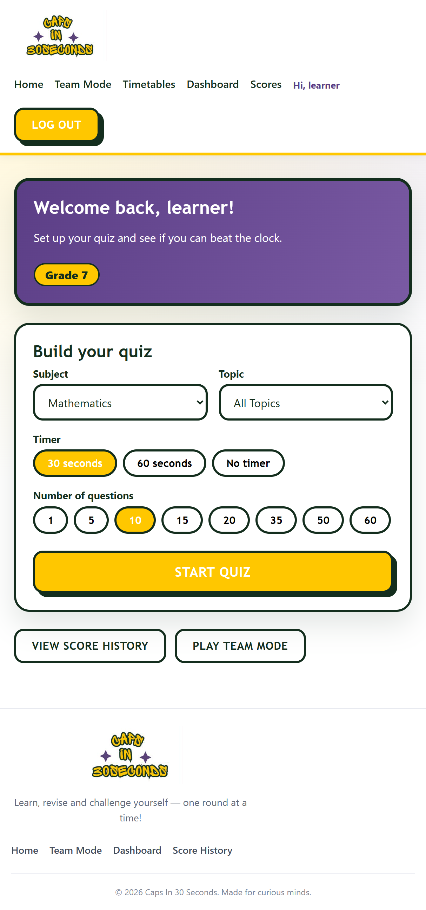
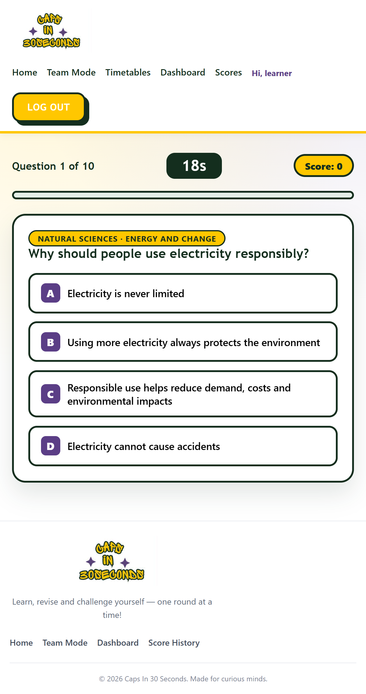
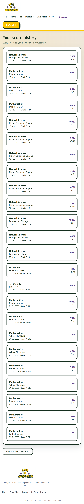
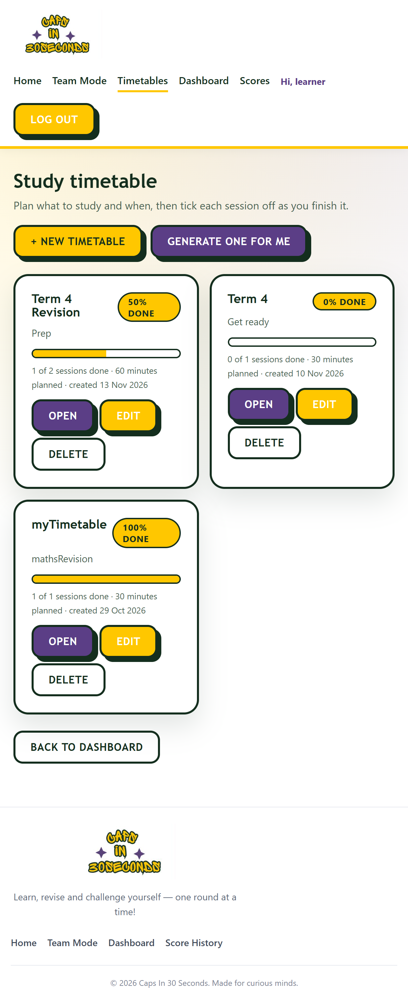

# Caps In 30 Seconds – Frontend

An interactive educational revision application designed to help learners practise school subjects through timed quizzes and team-based learning.

## Overview

Caps In 30 Seconds is a web-based learning application inspired by the South African Curriculum and Assessment Policy Statement (CAPS). It aims to make revision more engaging by combining subject-based quizzes, time challenges and interactive team activities.

The application provides learners with an opportunity to practise concepts, test their knowledge and reinforce their understanding through an interactive learning experience.

**Note:** The application uses curriculum-aligned prototype content and is not an official CAPS assessment platform.
## Screenshots

### Homepage


### Quiz Configuration



### Solo Quiz Mode



### Score History


## Live Application

### Timetables


## Live Application

- **Frontend:** [https://caps-in-30-frontend.vercel.app/](https://caps-in-30-frontend.vercel.app/)
- **Backend API:** capsin30-webapi-brgtara8cpbretbs.southafricanorth-01.azurewebsites.net
- **Backend Repository:** [https://github.com/Tsholo705/caps-in-30.Api.git](https://github.com/Tsholo705/caps-in-30.Api.git)

## Features

- **User Registration and Login:** Learner authentication with teacher-issued access codes.
- **Grade Selection:** Supports Grades 3, 7 and 8.
- **Subject-Based Learning:** Revision activities across Mathematics, English Home Language, Natural Sciences and Technology, where applicable to the selected grade.
- **Solo Quiz Mode:** Learners answer questions individually within configurable time limits.
- **Team Mode:** Supports 2–4 teams competing through timed rounds.
- **Quiz Configuration:** Learners can configure subjects, topics, question counts and available timer settings.
- **Interactive Learning:** Provides an engaging way to practise concepts and reinforce subject knowledge.

## Technologies Used

| Technology        | Purpose                        |
| ----------------- | ------------------------------ |
| React.js          | Frontend development           |
| JavaScript (ES6+) | Application logic              |
| HTML5             | Application structure          |
| CSS3              | Styling and responsive layouts |
| REST API          | Communication with the backend |
| Git & GitHub      | Version control                |
| Vercel            | Frontend deployment            |

## Application Architecture

The frontend is built using React and communicates with an ASP.NET Core Web API backend through HTTP requests.

The backend handles authentication, data retrieval and application operations, while the frontend manages the user interface and learner interactions.

## Getting Started

### Prerequisites

Before running the application locally, ensure you have:

- Node.js installed.
- npm installed.
- Git installed.
- Access to the backend API.

### 1. Clone the repository

```bash
git clone https://github.com/Tsholo705/caps-in-30-frontend.git
```

### 2. Navigate to the project directory

```bash
cd caps-in-30-frontend
```

### 3. Install dependencies

```bash
npm install
```

### 4. Configure environment variables

Create a `.env` file in the project root and configure the backend API URL.

```env
VITE_API_BASE_URL=capsin30-webapi-brgtara8cpbretbs.southafricanorth-01.azurewebsites.net
```


### 5. Start the development server

```bash
npm run dev
```

Open the local URL displayed in your terminal to access the application.

### 6. Build for production

```bash
npm run build
```

## Project Structure

The application follows a component-based React structure.

```text
caps-in-30-frontend/
│
├── public/
├── src/
│   ├── components/
│   ├── pages/
│   ├── styles/
│   ├── api.js
│   └── ...
│
├── .env.example
├── .gitignore
├── index.html
├── package.json
└── README.md
```

*The structure above is a simplified overview. Individual folders and files may differ as the project evolves.*

## Backend Integration

The frontend integrates with a separate ASP.NET Core Web API responsible for:

- User authentication and registration.
- Retrieving subjects and categories.
- Retrieving quiz questions.
- Managing application data.
- Supporting quiz-related operations.

The backend uses SQL Server for relational data storage.

## Deployment

The frontend is deployed using Vercel.

The application communicates with the backend hosted on Microsoft Azure.

## Future Improvements

Potential improvements include:

- Expanded curriculum coverage and question banks.
- Enhanced learner progress tracking.
- Additional learning and assessment features.
- Further improvements to accessibility and user experience.

## Author

Developed as a personal full-stack software development project.

**Technologies:** React.js | JavaScript | CSS | ASP.NET Core Web API | SQL Server
